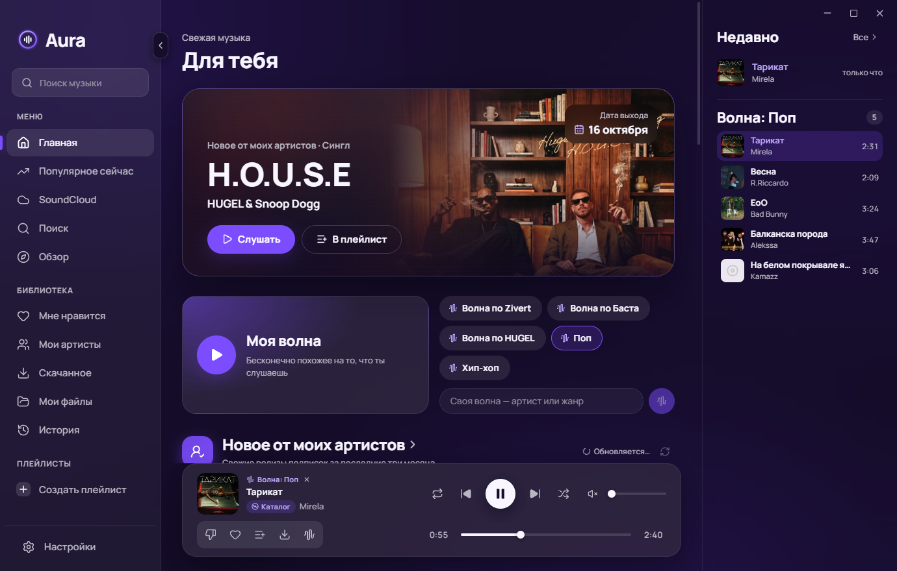
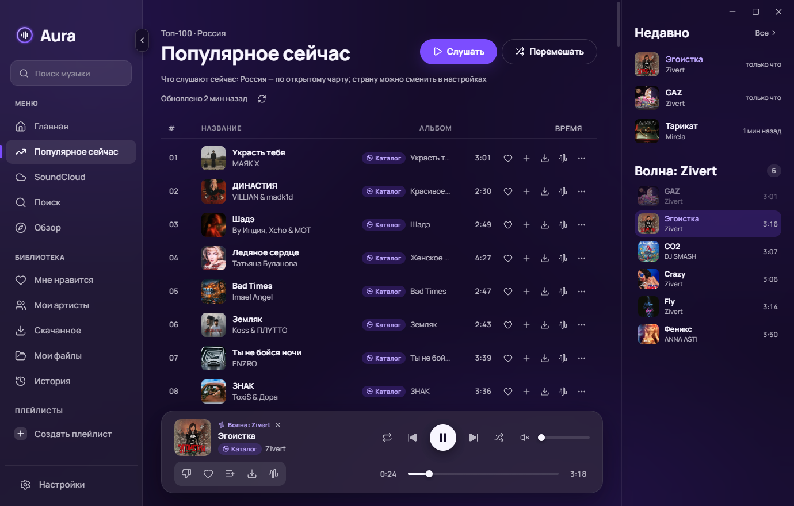
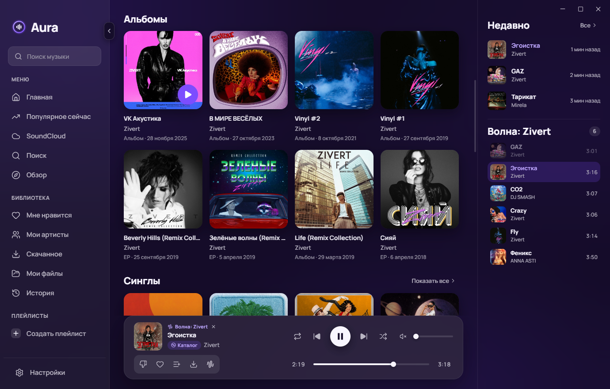
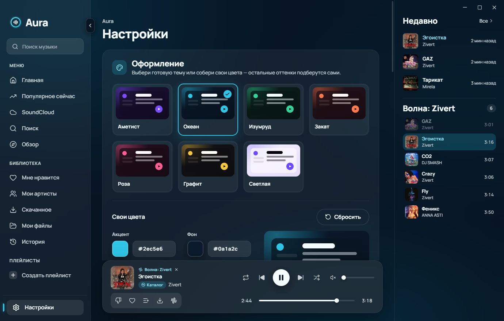

# Aura

Бесплатный аудиоплеер для Windows. Ищет и играет музыку с YouTube, SoundCloud, Internet Archive и из твоих папок на диске, ведёт «Мою волну» — бесконечную подборку похожих треков, которая подстраивается под то, что ты слушаешь. Без аккаунтов, без рекламы, всё хранится на твоём компьютере.



| Волна и очередь справа | Страница артиста: альбомы и синглы | Темы оформления |
|---|---|---|
|  |  |  |

## Возможности

- **Поиск по всем источникам сразу** — YouTube, SoundCloud, Internet Archive, «Мои файлы» и каталог песен; у каждого трека видно, откуда он. Один источник не ответил — остальные работают.
- **«Моя волна»** — бесконечная очередь похожих треков. Запускается от трека, артиста, жанра или своего запроса. Чипы на главной («Волна по …», жанры) собираются из того, что ты слушаешь, и меняются вместе с твоим вкусом.
- **Вкус** — Aura сама замечает, что ты дослушиваешь, лайкаешь и пропускаешь, и подстраивает волну и подборки. Ничего настраивать не нужно.
- **«Не нравится» и чёрный список** — скрытый трек или исполнитель больше не появляется в волнах и подборках; в своих списках он виден приглушённым, вернуть можно в один клик (весь список — в настройках).
- **Артисты** — страница с популярными треками, альбомами и синглами, похожими исполнителями; подписка и лента «Новое от моих артистов», блок «Свежее от похожих». Имя исполнителя кликабельно везде.
- **Популярное сейчас** — топ-100 песен чарта твоей страны (страну можно сменить в настройках) и раздел SoundCloud с его чартами.
- **Библиотека** — «Мне нравится», плейлисты с перетаскиванием, история, очередь справа со всем, что играет.
- **Скачивание** — любой трек или альбом сохраняется в папку «Музыка\Aura» и дальше играет без интернета.
- **Мои файлы** — подключи свои папки с музыкой (mp3, flac, m4a, ogg и др.), Aura прочитает теги и обложки.
- **Темы** — семь готовых тем (есть светлая) или свои цвета акцента и фона, остальные оттенки подберутся сами.
- Медиаклавиши клавиатуры, поиск по `Ctrl+K`, сессия восстанавливается после перезапуска.

## Скачать

Установщик для Windows 10/11 (64 бит) — на странице релизов:

**[github.com/danilaAfanasev/Auraplayer/releases](https://github.com/danilaAfanasev/Auraplayer/releases)**

Файл называется `Aura-Setup-<версия>.exe`.

## Установка

1. Запусти `Aura-Setup-<версия>.exe`.
2. Установщик не подписан сертификатом, поэтому Windows покажет синее окно **«Windows защитила ваш компьютер»** (SmartScreen). Нажми **«Подробнее»**, затем **«Выполнить в любом случае»**.
3. Выбери папку (по умолчанию — только для текущего пользователя, права администратора не нужны). Ярлык «Aura» появится на рабочем столе и в меню «Пуск».

## Первый запуск

- Aura сама скачает **yt-dlp** — компонент, через который она получает звук с YouTube и SoundCloud (с официальной страницы проекта на GitHub, с проверкой контрольной суммы). Ход загрузки виден внизу левой панели: «Готовлю YouTube и SoundCloud… 45%». Пока он качается, программой уже можно пользоваться; если сети нет — загрузка повторится при следующем запуске или по кнопке «Повторить».
- Откроется экран **«Что ты слушаешь?»**: выбери пару жанров и любимых артистов — «Моя волна» и подборки сразу подстроятся. Можно нажать «Пропустить»: Aura научится сама, пока ты слушаешь.

## Собрать из исходников

Нужны Windows 10/11, [Node.js](https://nodejs.org/) 24 и npm.

```sh
npm ci           # зависимости
npm run dev      # запустить в режиме разработки
npm run check    # проверка типов и тесты
npm run dist     # установщик release/Aura-Setup-<версия>.exe
```

Устройство программы — [docs/architecture.md](docs/architecture.md), словарь понятий — [CONTEXT.md](CONTEXT.md).

## Вопросы и ответы

**YouTube или SoundCloud работают медленно или не отвечают.**
Треки с YouTube, SoundCloud и из каталога Aura ищет при включении — это занимает несколько секунд, плеер показывает «Загружаю…» и ждёт, а не перескакивает. Если сервис не отвечает совсем, в твоей стране или сети он может быть ограничен — возможно, нужен VPN. Иногда помогает «Настройки → YouTube → Обновить yt-dlp».

**Нужен ли аккаунт YouTube или SoundCloud?**
Нет. Aura обращается к ним анонимно: без входа, без куки браузера, твои аккаунты не используются.

**Где хранятся мои данные?**
Библиотека, плейлисты, чёрный список, настройки и кэш лежат в `%APPDATA%\Aura` (вставь это в адресную строку Проводника). Скачанные треки — в папке «Музыка\Aura», её можно сменить в настройках. Чтобы перенести всё на другой компьютер, скопируй папку `%APPDATA%\Aura`.

**Как удалить Aura?**
«Параметры Windows → Приложения → Установленные приложения → Aura → Удалить». Твои плейлисты и настройки при этом остаются; чтобы стереть и их, удали папку `%APPDATA%\Aura`. Скачанная музыка в «Музыка\Aura» тоже остаётся — удали её вручную, если не нужна.

**Почему Aura не обновляется сама?**
Автообновления нет: новую версию скачай со страницы релизов и установи поверх — данные сохранятся. yt-dlp обновляется отдельно из настроек.

## Aura ничего о вас не собирает

Нет аккаунтов, аналитики, телеметрии и рекламы. Всё, что ты слушаешь, лайкаешь и скрываешь, хранится только на твоём компьютере. Aura обращается в сеть только за музыкой и её описанием (YouTube, SoundCloud, Internet Archive, открытые API каталога песен и похожих артистов) и на GitHub — за yt-dlp.

## Отказ от ответственности

Aura — некоммерческий проект для личного использования. Пользователь сам отвечает за соблюдение правил сервисов, к которым обращается программа, и авторских прав на музыку, которую слушает и скачивает. Aura не связана с YouTube, Google, SoundCloud, Apple, Deezer, Internet Archive и другими сервисами и не одобрена ими; их названия упоминаются только для описания работы программы. Программа предоставляется «как есть», без каких-либо гарантий.

## Лицензия

[MIT](LICENSE).
